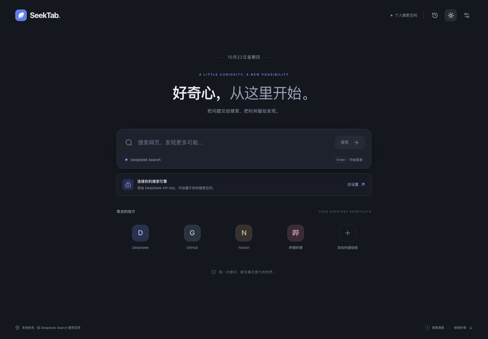

# SeekTab

**A personal new tab for web search, powered by your own DeepSeek API key.**

**English** · [简体中文](README_CN.md)

[](https://github.com/Wayne-Shen/seektab/actions/workflows/ci.yml)
[](LICENSE)

SeekTab replaces Chrome's New Tab page with a calm search workspace: structured web results, quick links, local history, and a short-lived result cache. Requests go directly from the extension to DeepSeek. There is no application backend or account system.

[Download the extension](https://github.com/Wayne-Shen/seektab/releases/latest) · [Report an issue](https://github.com/Wayne-Shen/seektab/issues) · [Contribute](CONTRIBUTING.md)


<details>
<summary>Dark mode preview</summary>



</details>

> The current extension interface is in Simplified Chinese. This repository provides both English and Chinese documentation. SeekTab is an independent project and is not affiliated with DeepSeek.

## Features

- **Manifest V3 New Tab replacement** with light, dark, and system themes.
- **Web results first:** titles, snippets, source names/domains, and publication dates when available. No generated AI answers.
- **Bring your own key:** masked key input, connection test, local saving, and key removal.
- **Quick links:** add, edit, and remove up to eight shortcuts.
- **Local history:** up to 50 unique successful searches, with opt-out and clearing controls.
- **Result cache:** up to 20 query/count combinations, with a fixed 15-minute lifetime and manual refresh.
- **Coordinated tabs:** same-origin locks serialize requests and local data updates; repeated concurrent searches can share a completed result.
- **Useful failure states:** cancellation, a 25-second timeout, empty results, offline errors, invalid keys, insufficient balance, and rate-limit countdowns.
- **Responsive layout and keyboard support:** native modal focus handling, Escape to close dialogs, reduced-motion support, and search shortcuts.

## Install

Requires **Chrome 120 or later** and a DeepSeek API key with access to the Search API. The documented local browser checks used Chrome for Testing 147; older supported versions have not all been tested individually.

1. Open [Releases](https://github.com/Wayne-Shen/seektab/releases/latest) and download `SeekTab-1.0.0-unpacked.zip`.
2. Extract the ZIP and keep the `SeekTab-unpacked` folder in a permanent location.
3. Open `chrome://extensions` in Chrome and enable **Developer mode**.
4. Choose **Load unpacked** and select the folder containing `manifest.json`.
5. Open a new tab and keep SeekTab if Chrome asks whether to accept the New Tab change.
6. Open Settings, enter your key, choose **测试连接** (Test connection), then **保存设置** (Save settings).

You do not need Node.js to install the prebuilt extension. No API key is included. This is an unpacked extension, not a Chrome Web Store listing.

**Connection testing sends one real Search API request for `DeepSeek` and may incur provider charges.** It does not save the key or write search history/cache. Saving settings persists the key locally.

## How search works

SeekTab uses the [official DeepSeek Search endpoint](https://api-docs.deepseek.com/api/search/), checked against the official documentation on **2026-10-22**:

```text
POST https://api.deepseek.com/v1/tools/search
Authorization: Bearer <your API key>
Content-Type: application/json

{"query":"your search","count":10,"need_content":false}
```

The UI offers 5, 10, or 20 results. Queries can contain up to 128 Unicode code points. Supported provider operators include `site:github.com`, `"exact phrase"`, `lang:zh`, and `after:2026-01-01`.

The extension renders the response's `results` array. It does not call a chat model or the Fetch API. Missing publication dates are omitted; missing site names fall back to the URL's hostname. See [API verification notes](docs/API-VERIFICATION.md) for implementation details and official references.

## Privacy and permissions

| Permission                   | Purpose                                                                |
| ---------------------------- | ---------------------------------------------------------------------- |
| `storage`                    | Store the key, settings, shortcuts, history, and cache on this device. |
| `https://api.deepseek.com/*` | Send search requests directly to the provider.                         |

There are no content scripts, background workers, analytics, remote fonts, remote favicon requests, or permissions for browsing history, bookmarks, or general website access. Extension code and UI resources are bundled locally. Results are rendered as escaped text, and links are limited to HTTP/HTTPS URLs without embedded credentials.

Submitted queries and the API key are sent to DeepSeek over HTTPS; the key is carried in the Authorization header. DeepSeek processes those requests under its own service policies. Opening a result or shortcut visits that website normally.

- Data uses `chrome.storage.local`, not Chrome Sync. A non-sensitive theme preference is also kept in `localStorage` to reduce startup flashing.
- **The saved API key is not encrypted.** Someone with access to your machine or browser profile may be able to read it. Avoid saving keys on untrusted shared devices.
- Disable or clear history and cache in Settings. Disabling requires saving settings; the clear buttons act immediately.
- Removing the key does not delete existing history or cached results. Clear those separately if needed.
- Clearing Chrome's browsing history does not clear extension storage. Use SeekTab's controls or uninstall the extension.
- Incognito mode is disabled for this extension.

Never commit a real API key, browser profile, or exported personal search data. See [SECURITY.md](SECURITY.md).

## Build from source

Stack: **React + TypeScript + Vite + Tailwind CSS**, with Lucide icons. Dependencies are pinned in `package-lock.json`.

Use **Node.js 22.12+**; CI uses Node.js 24. Then:

```sh
git clone https://github.com/Wayne-Shen/seektab.git
cd seektab
npm ci
npm test
npm run build
```

Load the generated `dist/` directory through `chrome://extensions`. After editing source, rebuild, reload the extension in Chrome, and open a new tab.

`npm run dev` starts Vite, but a normal webpage does not have `chrome.storage`. Use the loaded extension for complete end-to-end development.

### Checks

```sh
npm run format:check
npm test
npm run build
npx playwright install chromium
npm run test:e2e
```

Browser tests load the real unpacked extension into an isolated temporary Chromium profile and intercept the Search API. They need no real key and make no billable API calls. Reports and screenshots are written to `test-artifacts/` and are not committed.

Set `CHROMIUM_PATH` to a compatible existing Chromium / Chrome for Testing executable if needed. Use Playwright's Chromium for automated side-loading, as normal Chrome builds may restrict command-line extension loading.

The recorded validation includes **17 core tests and 22 browser checks**. It covers New Tab replacement, key handling, result fields, cache expiry rules, cross-tab coordination, shortcuts, responsive layouts, error states, cancellation, and clearing data during an in-flight request. See the [validation report](docs/TEST-REPORT.md).

**Real-account authentication and live search quality have not been verified with a user key.** Use Test connection after installation to validate your own account and network.

### Create distributable ZIPs

Packaging additionally requires Python 3:

```sh
npm run package
```

This builds the extension and writes the unpacked-extension ZIP, complete-source ZIP, and SHA-256 checksums to `release/`. Dependencies, temporary browser profiles, and test artifacts are excluded.

## Project layout

```text
.github/workflows/ci.yml   Build, core tests, and browser checks
public/manifest.json      Permissions, CSP, and New Tab entry
public/icons/             Local SVG source and PNG icons
src/App.tsx               Home, results, settings, history, and shortcuts
src/lib/api.ts            Search adapter, validation, cancellation, and errors
src/lib/store.ts          Local data, TTL, limits, and privacy controls
src/lib/search.ts         Request coordination and connection testing
src/style.css             Themes and responsive styling
tests/                    Core and browser integration tests
scripts/                  Bundle checks and release packaging
docs/                     API notes, validation records, and previews
```

## Usage notes

- Chrome normally focuses the address bar when a new tab opens. Click the search box first. Once the page has focus, `/` or `⌘K` / `Ctrl+K` focuses search.
- The extension replaces New Tab, not Chrome's startup behavior. If Chrome restores a previous session, open a new tab or choose the New Tab startup setting yourself.
- **刷新结果** (Refresh results) bypasses the cache and sends a new request. A normal repeated query uses a fresh matching cache entry, including while offline.
- Rate-limited requests do not retry automatically. Retry after the countdown. Provider account limits may also include traffic from other applications.
- Results and shortcuts open in a new tab by default; this can be changed in Settings.
- Keep the installed directory in place. Moving an unpacked extension can change its ID and separate it from the previous local settings.

## Contributing

Bug reports, documentation improvements, and pull requests are welcome. See [CONTRIBUTING.md](CONTRIBUTING.md) for setup and scope. Report security-sensitive issues according to [SECURITY.md](SECURITY.md).

## License

[MIT](LICENSE) © 2026 Wayne-Shen and SeekTab contributors.

Bundled dependencies retain their own licenses; see [THIRD_PARTY_NOTICES.txt](THIRD_PARTY_NOTICES.txt).
