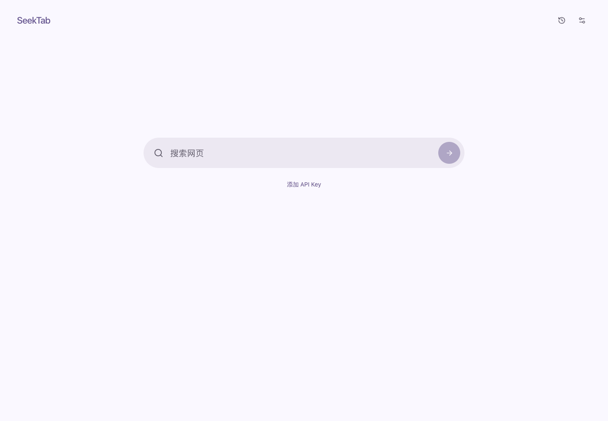
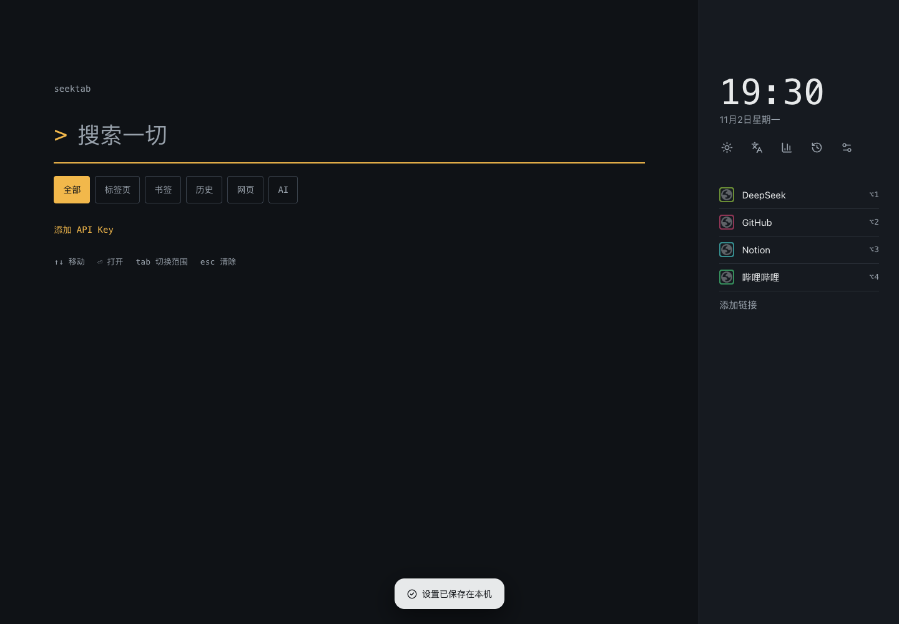

# SeekTab

**A personal new tab for searching the web, your tabs, bookmarks and history, with optional AI answers, using your own DeepSeek API key.**

**English** · [简体中文](README_CN.md)

[](https://github.com/Wayne-Shen/seektab/actions/workflows/ci.yml)
[](LICENSE)

SeekTab replaces Chrome's New Tab page with a keyboard-first "command" interface: a prompt-style search bar, search scopes, a clock and quick links on the right, and structured web results. Requests go directly from the extension to DeepSeek. There is no application backend or account system.

[Download the extension](https://github.com/Wayne-Shen/seektab/releases/latest) · [Report an issue](https://github.com/Wayne-Shen/seektab/issues) · [Contribute](CONTRIBUTING.md)



<details>
<summary>Dark mode preview</summary>



</details>

> The interface is available in Chinese and English (it follows your browser language by default). SeekTab is an independent project and is not affiliated with DeepSeek.

## Features

- **Command-style New Tab** (Manifest V3) with light, dark and system themes, four accent colours, and a 12/24-hour clock.
- **Search scopes:** All, Tabs, Bookmarks, History, Web and AI. Type to see matching rows; `↑`/`↓` move, `Enter` opens, `Tab` cycles the scope, `Esc` clears.
- **Local search:** open tabs (with switch-to-tab), bookmarks and Chrome browsing history are matched on this device as you type. Each source can be turned off in Settings.
- **Web results:** titles, snippets, source names/domains and publication dates when available, sortable by **relevance or date**.
- **Optional AI answers:** only when you ask. A streamed answer based on the search results, with numbered citations that link to real results.
- **Reset button** to clear the current query, results and AI answer in one click.
- **Quick links** with site icons (from Chrome's local favicon cache) and `⌥1`–`⌥9` shortcuts; up to eight, editable in Settings.
- **Chinese / English** and **light / dark** quick switches in the right-hand rail.
- **Bring your own key:** masked key input, connection test, local saving and key removal.
- **Local history and cache:** up to 50 unique successful searches and up to 20 cached query/count results with a fixed 15-minute lifetime; both can be disabled and cleared.
- **Usage and balance report** and local AI usage counts, refreshed only on demand.
- **Coordinated tabs, safe failures:** cross-tab request locks, cancellation, a 25-second timeout, rate-limit countdowns and clear error states.

## Install

Requires **Chrome 120 or later** and a DeepSeek API key with access to the Search API. The documented local browser checks used Chrome for Testing 147; older supported versions have not all been tested individually.

1. Open [Releases](https://github.com/Wayne-Shen/seektab/releases/latest) and download `SeekTab-1.4.0-unpacked.zip`.
2. Extract the ZIP and keep the `SeekTab-unpacked` folder in a permanent location.
3. Open `chrome://extensions` in Chrome and enable **Developer mode**.
4. Choose **Load unpacked** and select the folder containing `manifest.json`.
5. Open a new tab and keep SeekTab if Chrome asks whether to accept the New Tab change.
6. Open Settings (the sliders icon in the right-hand rail), enter your key, choose **Test connection**, then **Save settings**.

You do not need Node.js to install the prebuilt extension. No API key is included. This is an unpacked extension, not a Chrome Web Store listing.

**Connection testing sends one real Search API request for `DeepSeek` and may incur provider charges.** It does not save the key or write search history/cache. Saving settings persists the key locally.

## Update an existing installation

Back up the current extension folder, then replace its contents with the verified release ZIP's `SeekTab-unpacked` contents **at the same existing path**. In `chrome://extensions`, click **Reload** on the existing SeekTab entry and accept any new permissions (1.4.0 adds `tabs`, `bookmarks`, `history` and `favicon`). Compare the extension ID before and after. Keep the existing installation entry to retain local settings, saved keys, history, cache and shortcuts; do not uninstall or load a second folder to update. A new manifest key or a different unpacked path can change the ID.

Release ZIPs are built and tested by GitHub Actions and include SHA-256 checksums.

## Using SeekTab

- Chrome normally focuses the address bar when a new tab opens. Click the search box first. Once the page has focus, `/` or `⌘K` / `Ctrl+K` focuses search.
- **All** shows a "Search the web" row, an "Ask AI" row and matches from the enabled local sources. **Tabs / Bookmarks / History** show only that source, **Web** runs the DeepSeek search, and **AI** asks for an AI answer.
- Press `Enter` on a tab row to switch to that tab; on a bookmark or history row to open it. Rows from your earlier SeekTab searches appear under History as "Search again".
- Use the **Reset** button next to the search bar to clear the current search.
- On results, **By relevance / By date** re-sorts without a new request. Relevance follows DeepSeek's score and ranking; date puts the newest first and undated results last. The choice is remembered.
- Quick links open with `⌥1`–`⌥9`. Results and links open in a new tab by default; change this in Settings.
- The extension replaces New Tab, not Chrome's startup behaviour. If Chrome restores a previous session, open a new tab or choose the New Tab startup setting yourself.
- **Refresh results** bypasses the cache and sends a new request. A normal repeated query uses a fresh matching cache entry, including while offline.
- Rate-limited requests do not retry automatically; retry after the countdown.
- Keep the installed directory in place. Moving an unpacked extension can change its ID and separate it from the previous local settings.

## Local search: tabs, bookmarks and history

While you type, SeekTab queries Chrome's tabs, bookmarks and browsing history through Chrome's extension APIs; none of the matching happens remotely. Titles and URLs are shown as escaped text; only HTTP/HTTPS URLs can be opened. These results are never sent to DeepSeek, never used for AI, and never copied into SeekTab's storage. Turn any source off in Settings.

## Advanced search

Settings provide persistent site inclusion and exclusion, language codes, date bounds, an exact phrase, excluded words, 1–50 results, optional long summaries and provider scores. Filters are compiled into the official query syntax, and their combined query must fit 128 Unicode characters. When filters modify the query, the original question is sent as `ori_question`.

An optional IPv4 address can be entered for localized results; it is stored locally and sent to DeepSeek on searches. Optional page content is limited to 12,000 displayed characters per result and is not cached. Searches using filters, localization or page content bypass the results cache and may incur another provider charge on repetition. Scores are provider estimates, not fact checking. No IP address is detected automatically.

## AI answers

AI answers are optional and happen only when you ask: choose the **AI** scope (or the "Ask AI about …" row) or click **AI summary** on web results. SeekTab uses the Search results it already has (the `summary` field of the top results, 8 by default) and sends one streamed request to `POST https://api.deepseek.com/responses` (default model `deepseek-flash`).

- Only your question and those results are sent: never tabs, bookmarks, browsing history, or your key beyond authentication.
- The answer is plain text with numbered citations that link to the real result URLs; citations that do not match a result are removed. Model reasoning text is not shown.
- Answers are kept in memory only and are not saved.
- Each answer costs one Search call plus one model call, which may be billed. A first-use notice explains this. Settings offer the model, number of sources, answer length limit and a local daily request limit (default 20; a local budget, not a DeepSeek quota).
- If an answer is cut off or empty, raise the answer length limit in Settings.
- Typing and opening a new tab never call the model.

## Local API usage and balance

Open **API usage and balance** in the right-hand rail. Click Refresh to query the official balance endpoint and update a locally saved report snapshot; opening the report does not make a request. The report displays the snapshot cutoff and balance retrieval time, the tracking start, totals, up to 30 daily rows and, when present, local AI request and token counts (without question text). It counts completed Search requests made by this extension on this device, including connection tests, across API keys; cached searches and other applications are excluded. Daily aggregates are retained for up to 366 dates and do not contain queries or keys. Records begin when each feature was introduced, can be incomplete if storage is unavailable or a tab closes, and are not an authoritative provider bill. The official dashboard provides account-wide usage. Refreshing the balance uses the saved key and the existing DeepSeek host permission.

## How search works

SeekTab uses the [official DeepSeek Search endpoint](https://api-docs.deepseek.com/api/search/):

```text
POST https://api.deepseek.com/v1/tools/search
Authorization: Bearer <your API key>
Content-Type: application/json

{"query":"your search","count":10,"need_content":false}
```

The UI offers 1–50 results. Queries can contain up to 128 Unicode code points. Supported provider operators include `site:github.com`, `"exact phrase"`, `lang:zh` and `after:2026-01-01`.

Web results come from the response's `results` array. Missing publication dates are omitted; missing site names fall back to the URL's hostname. The Fetch API and the model's built-in `web_search` tool are not used. See [API verification notes](docs/API-VERIFICATION.md) for the contracts, the dates they were checked against official documentation, and what remains unverified.

## Privacy and permissions

| Permission                   | Purpose                                                                |
| ---------------------------- | ---------------------------------------------------------------------- |
| `storage`                    | Store the key, settings, shortcuts, history, and cache on this device. |
| `tabs`                       | Match open tab titles/URLs locally and switch to a chosen tab.         |
| `bookmarks`                  | Match bookmarks locally while you type.                                |
| `history`                    | Match Chrome browsing history locally while you type.                  |
| `favicon`                    | Show shortcut icons from Chrome's local favicon cache (no network).    |
| `https://api.deepseek.com/*` | Send search and AI requests directly to the provider.                  |

There are no content scripts, background workers, analytics, remote fonts, remote favicon requests, or general website access. Tabs, bookmarks and browsing history are matched only on this device while you type (each source can be turned off in Settings); they are never uploaded or copied into SeekTab storage, and your query goes to DeepSeek only when you choose a web or AI row. Extension code and UI resources are bundled locally. Results are rendered as escaped text, and links are limited to HTTP/HTTPS URLs without embedded credentials.

Submitted queries, AI prompts (your question plus the result summaries) and the API key are sent to DeepSeek over HTTPS; the key is carried in the Authorization header. DeepSeek processes those requests under its own service policies. Opening a result or shortcut visits that website normally.

- Data uses `chrome.storage.local`, not Chrome Sync. Non-sensitive theme, accent and language preferences are also kept in `localStorage` to reduce startup flashing.
- **The saved API key is not encrypted.** Someone with access to your machine or browser profile may be able to read it. Avoid saving keys on untrusted shared devices.
- Disable or clear history and cache in Settings. Disabling requires saving settings; the clear buttons act immediately.
- Removing the key does not delete existing history or cached results. Clear those separately if needed.
- Clearing Chrome's browsing history does not clear extension storage. Use SeekTab's controls or uninstall the extension.
- Incognito mode is disabled for this extension.

Never commit a real API key, browser profile, or exported personal search data. See [SECURITY.md](SECURITY.md).

## Build from source

Stack: **React + TypeScript + Vite + Tailwind CSS**, with Lucide icons. Dependencies are pinned in `package-lock.json`.

Use **Node.js 22.12+**; CI uses Node.js 24. Then:

```sh
git clone https://github.com/Wayne-Shen/seektab.git
cd seektab
npm ci
npm test
npm run build
```

Load the generated `dist/` directory through `chrome://extensions`. After editing source, rebuild, reload the extension in Chrome, and open a new tab.

`npm run dev` starts Vite, but a normal webpage does not have `chrome.storage`. Use the loaded extension for complete end-to-end development.

### Checks

```sh
npm run format:check
npm test
npm run build
npx playwright install chromium
npm run test:e2e
```

Browser tests load the real unpacked extension into an isolated temporary Chromium profile and intercept the DeepSeek APIs (Search, balance and AI). They need no real key and make no billable API calls. Reports and screenshots are written to `test-artifacts/` and are not committed.

Set `CHROMIUM_PATH` to a compatible existing Chromium / Chrome for Testing executable if needed. Use Playwright's Chromium for automated side-loading, as normal Chrome builds may restrict command-line extension loading.

The v1.4.0 validation includes **38 unit tests and 30 browser checks**. They cover New Tab replacement, key handling, result fields and sorting, cache expiry rules, cross-tab coordination, local tab/bookmark/history search, AI streaming and citation validation, language and theme switching, error states, cancellation, and clearing data during an in-flight request. See the [validation report](docs/TEST-REPORT.md) (an older, v1.0.0-era record).

**All automated checks use mocked responses.** The maintainer manually confirmed a streamed AI answer with their own key; live search quality, AI pricing and the non-streaming AI response shape have not been verified. Use Test connection after installation to validate your own account and network.

### Create distributable ZIPs

Packaging additionally requires Python 3:

```sh
npm run package
```

This builds the extension and writes the unpacked-extension ZIP, complete-source ZIP and SHA-256 checksums to `release/`. Dependencies, temporary browser profiles and test artifacts are excluded.

## Project layout

```text
.github/workflows/ci.yml   Build, core tests, and browser checks
public/manifest.json      Permissions, CSP, and New Tab entry
public/icons/             Local SVG source and PNG icons
src/App.tsx               Command home, results, AI panel, settings, history, links
src/lib/api.ts            Search adapter, validation, sorting, errors
src/lib/ai.ts             AI prompt, streamed /responses client, citation checks
src/lib/browser.ts        Local tab, bookmark, and history search
src/lib/store.ts          Local data, TTL, limits, and privacy controls
src/lib/search.ts         Request coordination and connection testing
src/lib/billing.ts        Balance and local usage report
src/lib/i18n.ts, en.ts    Chinese/English strings
src/style.css             Themes and responsive styling
tests/                    Unit and browser integration tests
scripts/                  Bundle checks and release packaging
docs/                     API notes, validation records, and previews
```

## Contributing

Continuing development with an agent? Start with [agent.md](agent.md), the repository instructions in [AGENTS.md](AGENTS.md), and the development [handoff](HANDOFF.md).

Bug reports, documentation improvements, and pull requests are welcome. See [CONTRIBUTING.md](CONTRIBUTING.md) for setup and scope. Report security-sensitive issues according to [SECURITY.md](SECURITY.md).

## License

[MIT](LICENSE) © 2026 Wayne-Shen and SeekTab contributors.

Bundled dependencies retain their own licenses; see [THIRD_PARTY_NOTICES.txt](THIRD_PARTY_NOTICES.txt).
