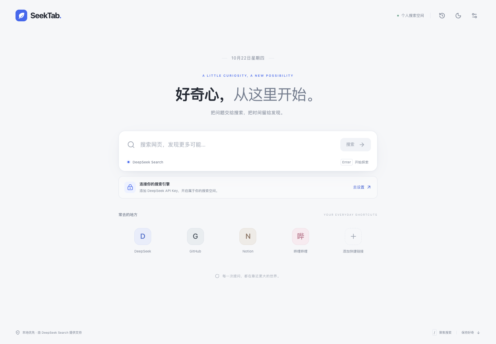

# SeekTab

[English](README.md) · **简体中文**

[下载最新版本](https://github.com/Wayne-Shen/seektab/releases/latest) · [反馈问题](https://github.com/Wayne-Shen/seektab/issues) · [参与贡献](CONTRIBUTING.md)



> 当前扩展界面使用简体中文，仓库提供中英双语文档。本项目为独立开源项目，与 DeepSeek 官方无隶属关系。

一个轻盈的个人搜索新标签页。使用自己的 DeepSeek API Key，直接获取网页结果；无后端、无账号系统、无 AI 回答。

## 安装（无需编译）

1. 从 [Releases](https://github.com/Wayne-Shen/seektab/releases/latest) 下载并解压 `SeekTab-1.0.0-unpacked.zip`，将 `SeekTab-unpacked` 文件夹放到一个长期保留的位置。
2. 在 Chrome 地址栏输入 `chrome://extensions`，开启右上角的 **开发者模式**。
3. 点击 **加载已解压的扩展程序**，选择包含 `manifest.json` 的 **SeekTab-unpacked 文件夹**。不要选择 ZIP，也不要选择它的上一级文件夹。
4. 新建标签页。如果 Chrome 询问是否保留更改，选择保留 SeekTab。
5. 点击右上角设置图标，填写自己的 DeepSeek API Key，点击 **测试连接**，成功后点击 **保存设置**。

需要 Chrome 120 或更新版本。安装包已经编译好，安装时不需要 Node.js 或依赖下载。没有内置密钥。

**首次使用说明：** 测试连接会实际调用一次 Search 接口，搜索词为「DeepSeek」，可能产生 API 费用；测试不保存密钥，也不写入历史或缓存。保存设置后密钥才会留在本机。

## 已实现的功能

- Manifest V3 新标签页替换，浅色、深色及跟随系统。
- DeepSeek 网页搜索，展示标题、短摘要、来源域名及可用的发布时间；未知时间不显示。
- 每次返回 5 / 10 / 20 条，默认 10 条；支持 API 原生搜索操作符。
- 自定义快捷链接：新增、编辑、删除，最多 8 个；鼠标悬停或键盘聚焦可显示编辑入口。
- 密钥掩码、显示/隐藏、连接测试、保存和立即移除。
- 最近 50 条成功搜索，按搜索词去重；可关闭、可清除。
- 最多 20 组本地结果缓存，固定有效期 15 分钟；复用不会延长有效期，可手动刷新。
- 缓存命中无需网络；多个 SeekTab 标签页通过同源锁共享结果并协调请求。
- 请求取消、25 秒超时、无结果、网络故障、错误响应、密钥无效、余额不足、服务器错误和限流倒计时。
- 响应式布局、原生模态框的键盘焦点限制、Escape 关闭、减少动画偏好。

## 使用提示

- 输入关键词后按 Enter，或点击搜索按钮。
- 页面已有焦点时，按 `/` 或 `⌘K` / `Ctrl+K` 聚焦搜索框。Chrome 打开新标签页时通常把焦点放在地址栏，需要先点击页面搜索框。这属于浏览器行为。
- 本扩展替换新标签页，不会主动改动 Chrome 的启动方式。若 Chrome 设置为「继续浏览上次打开的网页」，启动时可能恢复旧页面；新建标签页即可使用 SeekTab。希望启动即展示时，可自行在 Chrome 设置中选择「打开新标签页」。
- 这是网页结果 MVP：不调用聊天模型、不生成 AI 综合回答、不自动翻页。
- `刷新结果` 会绕过缓存重新请求；普通重复搜索会优先使用 15 分钟内的缓存。
- 默认在新标签页打开结果和快捷链接，可在设置中改为当前标签页。
- 搜索操作符示例：`site:github.com`、`"精确短语"`、`lang:zh`、`after:2026-01-01`。关键词总长度最多 128 个 Unicode 字符。
- 限流后不会自动重试。倒计时结束后自行重试，缓存命中仍可使用。

## 数据与权限

扩展只申请 `storage` 和 `https://api.deepseek.com/*` 主机权限。没有 `tabs`、`history`、`activeTab`、书签、广泛网址访问或内容脚本权限。

用户提交的搜索词通过 HTTPS 直接发给 DeepSeek；API Key 仅放在 Authorization 请求头。DeepSeek 将按其服务政策处理收到的数据。本扩展无中转服务器、无遥测、无第三方统计，不下载远程字体或网站图标。打开网页链接后，浏览器会正常访问该网站。

密钥、偏好、快捷链接、搜索历史和缓存存于 `chrome.storage.local`，不使用 `storage.sync`，也不导出密钥。缓存和历史均可单独关闭、清除；关闭选项需点击保存设置。移除已存密钥立即生效，已缓存结果仍可读取；如果需要一并清理，请另行清除缓存和历史。主题另有一份不含隐私数据的 `localStorage` 偏好，用于减少初始闪烁。

**本地密钥并未加密。** 有本机或浏览器配置文件访问权限的人可能读取密钥；不要在不信任的共享电脑保存。扩展仅适合个人使用，不应把真实密钥写进源码、打包分发或提交到仓库。需要撤销密钥时，在 DeepSeek 平台停用它。

页面使用严格 CSP，执行代码和界面资源全部来自安装包。所有搜索文本由 React 转义；链接仅接受不含凭据的 HTTP/HTTPS 地址。没有后台服务、内容脚本或允许网页访问的消息桥。无痕模式不启用本扩展。清除 Chrome 网页历史不会清掉扩展数据，应使用 SeekTab 设置或卸载扩展。

## 从源码构建

技术栈：React + TypeScript + Vite + Tailwind CSS，Lucide 图标。所有依赖版本记录在 `package-lock.json`。

推荐 Node.js 22.12+，CI 使用 Node.js 24。在源码目录运行：

```sh
npm ci
npm test
npm run build
```

构建结果在 `dist/`。在 `chrome://extensions` 加载此目录即可。修改源码后重新执行构建，在扩展管理页点击「重新加载」，然后打开新的标签页。`npm run dev` 是 Vite 开发服务器；普通网页缺少 `chrome.storage`，完整功能应通过加载 `dist/` 的扩展环境调试。

浏览器集成测试：

```sh
npx playwright install chromium
npm run test:e2e
```

测试使用临时独立浏览器配置和模拟 Search API 响应，不接触你的 Chrome 配置、不使用真实密钥、不产生 API 请求费用。需要使用现有测试浏览器时，设置 `CHROMIUM_PATH` 环境变量指向支持加载扩展的 Chromium / Chrome for Testing 可执行文件。普通稳定版 Chrome 可能限制命令行侧载，应使用 Playwright Chromium。

浏览器测试会生成 `test-artifacts/` 中的报告和界面截图。生产安装包不包含测试数据。`npm run build` 同时检查 Manifest、资源、权限和应用渲染代码。

主要文件：

```text
public/manifest.json       MV3 清单、权限、CSP 与新标签页入口
src/App.tsx               首页、结果、设置、历史、快捷链接
src/lib/api.ts            官方接口适配、验证、错误、取消与超时
src/lib/store.ts          本地数据、固定 TTL、容量边界、隐私清除
src/lib/search.ts         缓存协调、跨标签页请求锁、连接测试
src/style.css             Tailwind 基础与响应式主题样式
tests/core.test.ts         核心行为测试
tests/extension.mjs        真实解压扩展的浏览器集成测试
scripts/check-bundle.mjs   构建产物检查
docs/API-VERIFICATION.md   官方接口核实记录与设计依据
```

## 常见问题

| 情况                                | 处理方式                                                                                       |
| ----------------------------------- | ---------------------------------------------------------------------------------------------- |
| 打开 ZIP 或 `index.html` 后无法工作 | 请通过扩展管理页加载包含 `manifest.json` 的文件夹。                                            |
| 新标签页没有变为 SeekTab            | 检查扩展是否启用、是否保留新标签页更改，以及是否有其他新标签页扩展竞争。                       |
| API Key 无效                        | 在设置中更新自己的 API Key；网页聊天登录凭证不是开放平台 API Key。                             |
| 余额不足                            | 在 DeepSeek 开放平台处理账户余额后重试。                                                       |
| 无法连接                            | 检查网络、代理以及扩展对 `api.deepseek.com` 的网站访问权限。                                   |
| 请求频繁                            | 等待倒计时结束后再试；同一账户在其他工具上的请求也可能共享服务端限额。                         |
| 结果没有时间或站点名称              | API 可能不提供时间；名称缺失时显示域名。                                                       |
| 搜索内容似乎未更新                  | 点击「刷新结果」，或等待 15 分钟缓存到期。                                                     |
| 不想保留查询内容                    | 在设置关闭历史与缓存并保存；也可立即点击清除按钮。                                             |
| 更新扩展                            | 保留原文件夹位置，替换内容后在扩展管理页重新加载。更换路径可能导致扩展 ID 变化和本地设置独立。 |

## 官方依据与验证范围

接口在 **2026-10-22** 对照 [DeepSeek Search API Reference](https://api-docs.deepseek.com/api/search/) 与 [网页搜索与抓取指南](https://api-docs.deepseek.com/zh-cn/guides/search/) 核实。扩展跨域方式参照 [Chrome 官方网络请求说明](https://developer.chrome.com/docs/extensions/develop/concepts/network-requests)。

交付时已进行类型检查、生产构建、核心测试和真实扩展加载的模拟 API 浏览器测试。**没有真实 API Key，未声称已完成真实账户的鉴权、付费调用或在线结果质量验证。** 安装后使用「测试连接」完成你账户的最终验证。Chrome 服务政策或网络环境仍可能影响真实请求。

生成发布 ZIP 还需要 Python 3，运行 `npm run package`，将在 `release/` 生成扩展安装包、完整源码包和 SHA-256 校验文件。

欢迎反馈问题和提交改进，参见 [贡献指南](CONTRIBUTING.md)；敏感问题请按 [安全说明](SECURITY.md) 处理。

本项目原创代码采用 MIT 许可，第三方库保留各自许可，见 `LICENSE` 与 `THIRD_PARTY_NOTICES.txt`。
