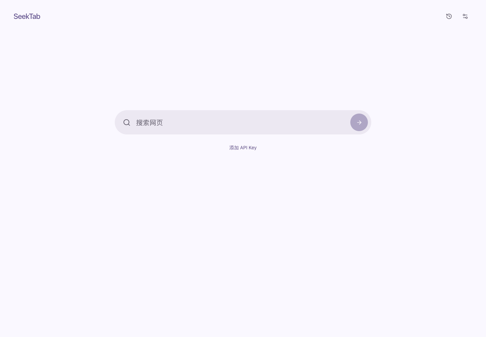
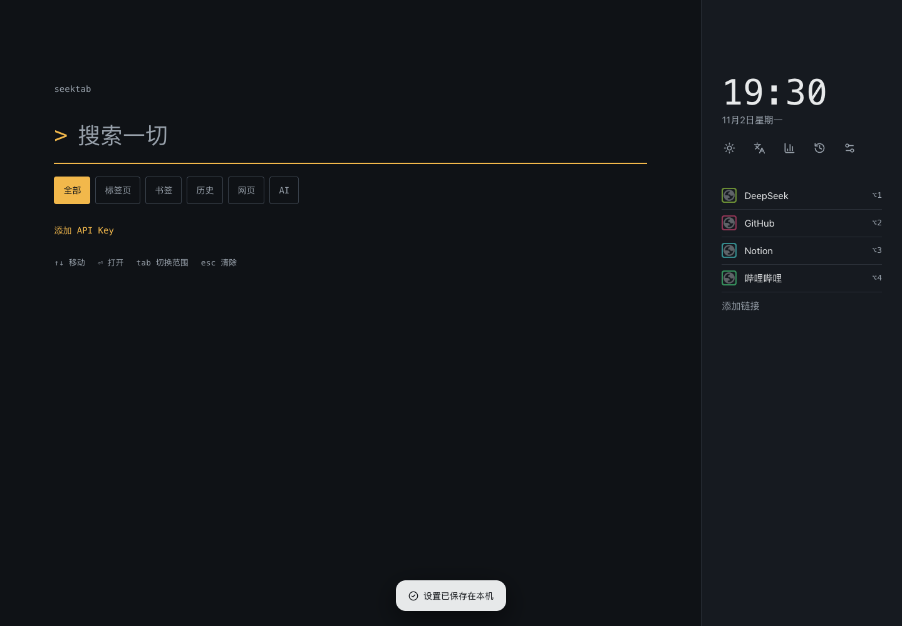

# SeekTab

[English](README.md) · **简体中文**

[下载最新版本](https://github.com/Wayne-Shen/seektab/releases/latest) · [反馈问题](https://github.com/Wayne-Shen/seektab/issues) · [参与贡献](CONTRIBUTING.md)



<details>
<summary>深色界面预览</summary>



</details>

> 界面支持中文和 English（默认跟随浏览器语言），仓库提供中英双语文档。本项目为独立开源项目，与 DeepSeek 官方无隶属关系。

Command 风格的键盘优先新标签页：提示符搜索栏、搜索范围、右侧时钟与快捷链接，以及结构化网页结果。可搜索网页、已打开的标签页、书签和浏览历史，并提供可选的 AI 回答。使用自己的 DeepSeek API Key，请求直接从扩展发往 DeepSeek；无后端、无账号系统。

## 已实现的功能

- **Command 风格新标签页**（Manifest V3）：浅色、深色及跟随系统，四种强调色，12/24 小时制时钟。
- **搜索范围**：全部、标签页、书签、历史、网页、AI。输入后显示匹配行；`↑`/`↓` 移动，`Enter` 打开，`Tab` 切换范围，`Esc` 清除。
- **本机搜索**：输入时在本机匹配已打开的标签页（可直接切换）、书签和 Chrome 浏览历史，可在设置中分别关闭。
- **网页结果**：标题、短摘要、来源域名及可用的发布时间，可按**相关度或日期**排序。
- **可选 AI 回答**：仅在你主动提出时生成；基于搜索结果流式输出，带指向真实结果的编号引用。
- **重置按钮**：一键清除当前搜索词、结果和 AI 回答。
- **快捷链接**：显示网站图标（来自 Chrome 本地图标缓存），支持 `⌥1`–`⌥9` 快捷键，最多 8 个，可在设置中编辑。
- 右栏提供 **中文 / English** 与 **浅色 / 深色** 的一键切换。
- 自带密钥：密钥掩码、显示/隐藏、连接测试、本机保存和立即移除。
- 本机历史与缓存：最近 50 条成功搜索，最多 20 组结果缓存（固定有效期 15 分钟）；均可关闭、可清除。
- 用量与余额报表及本机 AI 用量计数，仅在手动刷新时更新。
- 跨标签页请求锁、请求取消、25 秒超时、限流倒计时和清晰的错误提示。

## 安装（无需编译）

1. 从 [Releases](https://github.com/Wayne-Shen/seektab/releases/latest) 下载并解压 `SeekTab-1.4.0-unpacked.zip`，将 `SeekTab-unpacked` 文件夹放到一个长期保留的位置。
2. 在 Chrome 地址栏输入 `chrome://extensions`，开启右上角的 **开发者模式**。
3. 点击 **加载已解压的扩展程序**，选择包含 `manifest.json` 的 **SeekTab-unpacked 文件夹**。不要选择 ZIP，也不要选择它的上一级文件夹。
4. 新建标签页。如果 Chrome 询问是否保留更改，选择保留 SeekTab。
5. 点击右栏的设置图标，填写自己的 DeepSeek API Key，点击 **测试连接**，成功后点击 **保存设置**。

需要 Chrome 120 或更新版本。安装包已经编译好，安装时不需要 Node.js 或依赖下载。没有内置密钥。

**首次使用说明：** 测试连接会实际调用一次 Search 接口，搜索词为「DeepSeek」，可能产生 API 费用；测试不保存密钥，也不写入历史或缓存。保存设置后密钥才会留在本机。

## 更新已有安装

先备份当前扩展文件夹，再将经过校验的发布 ZIP 中 `SeekTab-unpacked` 的内容替换到**原来的同一路径**。在 `chrome://extensions` 点击已有 SeekTab 条目的「重新加载」并接受新增权限（1.4.0 新增 `tabs`、`bookmarks`、`history`、`favicon`），核对更新前后的扩展 ID。保留原安装条目可保留本地设置、密钥、历史、缓存与快捷链接；更新时不要卸载或加载另一目录。新的 manifest key 或不同的解压路径可能改变 ID。

发布 ZIP 由 GitHub Actions 构建并测试，附带 SHA-256 校验文件。

## 使用提示

- Chrome 打开新标签页时通常把焦点放在地址栏，需要先点击页面搜索框。页面已有焦点时，按 `/` 或 `⌘K` / `Ctrl+K` 聚焦搜索框。这属于浏览器行为。
- **全部** 范围显示「搜索网页」行、「向 AI 提问」行以及已启用本机来源的匹配项；**标签页 / 书签 / 历史** 只显示对应来源；**网页** 执行 DeepSeek 搜索；**AI** 请求 AI 回答。
- 在标签页行按 `Enter` 切换到该标签页；在书签或历史行按 `Enter` 打开链接。你以前在 SeekTab 中的搜索会以「再次搜索」出现在历史里。
- 搜索栏旁的「重置」按钮会清除当前搜索。
- 结果页的「按相关度 / 按日期」无需新请求即可重新排序：相关度遵循 DeepSeek 的评分和排序；日期为最新在前、无日期的排在最后。选择会被记住。
- 快捷链接可用 `⌥1`–`⌥9` 打开。默认在新标签页打开结果和快捷链接，可在设置中改为当前标签页。
- 本扩展替换新标签页，不会主动改动 Chrome 的启动方式。若 Chrome 设置为「继续浏览上次打开的网页」，启动时可能恢复旧页面；新建标签页即可使用 SeekTab。
- `刷新结果` 会绕过缓存重新请求；普通重复搜索会优先使用 15 分钟内的缓存。
- 限流后不会自动重试。倒计时结束后自行重试，缓存命中仍可使用。
- 搜索操作符示例：`site:github.com`、`"精确短语"`、`lang:zh`、`after:2026-01-01`。关键词总长度最多 128 个 Unicode 字符。
- 请保持安装目录不动：移动解压的扩展可能改变扩展 ID，使其与此前的本地设置分离。

## 本机搜索：标签页、书签与历史

输入时，SeekTab 通过 Chrome 扩展 API 在本机查询标签页、书签和浏览历史，匹配过程不涉及任何远程服务。标题和网址按转义文本显示，只有 HTTP/HTTPS 链接可以被打开。这些内容不会发送给 DeepSeek，不会用于 AI，也不会被复制到 SeekTab 的存储中。可在设置中关闭任一来源。

## 高级搜索

在设置中可配置限定或排除站点、语言代码、日期范围、精确短语、排除关键词、1–50 条结果、长摘要与服务方评分。筛选条件会编译成官方搜索语法；搜索词和筛选合计不能超过 128 个 Unicode 字符。筛选改写查询时会将原始问题作为 `ori_question` 发送。

可选输入用于本地化的 IPv4 地址；地址保存在本机并随搜索发送给 DeepSeek，扩展不会自动检测 IP。可选网页正文每条最多显示 12,000 字符，且不写入缓存。使用筛选、本地化或正文的搜索会绕过结果缓存，重复搜索可能再次计费。评分是服务方提供的指标，不代表事实核验。

## AI 回答

AI 回答为可选功能，仅在你主动提出时发生：选择 **AI** 范围（或「向 AI 提问」行），或在网页结果上点击 **AI 总结**。SeekTab 使用已有的搜索结果（前几条结果的 `summary` 字段，默认 8 条），向 `POST https://api.deepseek.com/responses` 发送一次流式请求（默认模型 `deepseek-flash`）。

- 只发送你的问题和这些结果，不发送标签页、书签、浏览历史，密钥也仅用于鉴权。
- 回答为纯文本，带有指向真实结果链接的编号引用；与结果不对应的引用会被移除；不显示模型的推理文本。
- 回答只保存在内存中，不落盘。
- 每次回答包含一次搜索和一次模型调用，都可能计费；首次使用会有提示。设置中可调整模型、结果数、回答长度上限和本机每日请求上限（默认 20，是本机预算而非 DeepSeek 官方额度）。
- 若回答被截断或为空，请在设置中调高回答长度上限。
- 输入和打开新标签页不会调用模型。

## 本机 API 用量与余额

通过右栏的「API 用量与余额」打开报表；只有点击「刷新」才查询官方余额并更新本地快照。报表显示数据截止时间、余额查询时间、记录起点、汇总、最近 30 个有请求日期的表格，以及（如有）本机 AI 请求和 token 计数（不含问题内容）。统计仅包含本设备此扩展已完成的 Search 请求（含连接测试和使用过的各个 API Key），不含缓存命中及其他应用。按日聚合最多保留 366 个有请求的日期，不记录搜索词或密钥；各功能的记录自其上线后开始，关闭标签页或存储不可用可能造成遗漏。该报表不是官方账单，账户完整用量请查看 DeepSeek 控制台。余额刷新使用已保存的密钥和现有 DeepSeek 域名权限。

## 数据与权限

扩展申请 `storage`、`tabs`、`bookmarks`、`history`、`favicon` 和 `https://api.deepseek.com/*` 主机权限。`tabs`、`bookmarks`、`history` 仅用于在新标签页输入时于本机匹配已打开的标签页、书签和 Chrome 浏览历史（可在设置中分别关闭）；这些内容不会上传、不会被保存副本，只有选择网页或 AI 行时才会把搜索词发送给 DeepSeek。`favicon` 仅用于从 Chrome 本地图标缓存显示快捷链接图标（不发起网络请求）。没有 `activeTab`、广泛网址访问或内容脚本权限。

用户提交的搜索词、AI 请求内容（你的问题和搜索结果摘要）通过 HTTPS 直接发给 DeepSeek；API Key 仅放在 Authorization 请求头。DeepSeek 将按其服务政策处理收到的数据。本扩展无中转服务器、无遥测、无第三方统计，不下载远程字体或网站图标。打开网页链接后，浏览器会正常访问该网站。

密钥、偏好、快捷链接、搜索历史和缓存存于 `chrome.storage.local`，不使用 `storage.sync`，也不导出密钥。缓存和历史均可单独关闭、清除；关闭选项需点击保存设置。移除已存密钥立即生效，已缓存结果仍可读取；如果需要一并清理，请另行清除缓存和历史。主题、强调色和语言另有不含隐私数据的 `localStorage` 偏好，用于减少初始闪烁。

**本地密钥并未加密。** 有本机或浏览器配置文件访问权限的人可能读取密钥；不要在不信任的共享电脑保存。扩展仅适合个人使用，不应把真实密钥写进源码、打包分发或提交到仓库。需要撤销密钥时，在 DeepSeek 平台停用它。

页面使用严格 CSP，执行代码和界面资源全部来自安装包。所有搜索文本由 React 转义；链接仅接受不含凭据的 HTTP/HTTPS 地址。没有后台服务、内容脚本或允许网页访问的消息桥。无痕模式不启用本扩展。清除 Chrome 网页历史不会清掉扩展数据，应使用 SeekTab 设置或卸载扩展。

## 从源码构建

技术栈：React + TypeScript + Vite + Tailwind CSS，Lucide 图标。所有依赖版本记录在 `package-lock.json`。

推荐 Node.js 22.12+，CI 使用 Node.js 24。在源码目录运行：

```sh
npm ci
npm test
npm run build
```

构建结果在 `dist/`。在 `chrome://extensions` 加载此目录即可。修改源码后重新执行构建，在扩展管理页点击「重新加载」，然后打开新的标签页。`npm run dev` 是 Vite 开发服务器；普通网页缺少 `chrome.storage`，完整功能应通过加载 `dist/` 的扩展环境调试。

浏览器集成测试：

```sh
npx playwright install chromium
npm run test:e2e
```

测试使用临时独立浏览器配置和模拟的 DeepSeek 接口（搜索、余额、AI），不接触你的 Chrome 配置、不使用真实密钥、不产生 API 请求费用。需要使用现有测试浏览器时，设置 `CHROMIUM_PATH` 环境变量指向支持加载扩展的 Chromium / Chrome for Testing 可执行文件。普通稳定版 Chrome 可能限制命令行侧载，应使用 Playwright Chromium。

浏览器测试会生成 `test-artifacts/` 中的报告和界面截图。生产安装包不包含测试数据。`npm run build` 同时检查 Manifest、资源、权限和应用渲染代码。

主要文件：

```text
public/manifest.json       MV3 清单、权限、CSP 与新标签页入口
src/App.tsx               Command 首页、结果、AI 面板、设置、历史、快捷链接
src/lib/api.ts            官方接口适配、验证、排序、错误、取消与超时
src/lib/ai.ts             AI 提示、流式 /responses 客户端、引用校验
src/lib/browser.ts        本机标签页、书签、历史搜索
src/lib/store.ts          本地数据、固定 TTL、容量边界、隐私清除
src/lib/search.ts         缓存协调、跨标签页请求锁、连接测试
src/lib/billing.ts        余额与本机用量报表
src/lib/i18n.ts, en.ts    中英文文案
src/style.css             Tailwind 基础与响应式主题样式
tests/                     单元测试与浏览器集成测试
scripts/check-bundle.mjs   构建产物检查
docs/API-VERIFICATION.md   官方接口核实记录与设计依据
```

## 常见问题

| 情况                                | 处理方式                                                                                       |
| ----------------------------------- | ---------------------------------------------------------------------------------------------- |
| 打开 ZIP 或 `index.html` 后无法工作 | 请通过扩展管理页加载包含 `manifest.json` 的文件夹。                                            |
| 新标签页没有变为 SeekTab            | 检查扩展是否启用、是否保留新标签页更改，以及是否有其他新标签页扩展竞争。                       |
| API Key 无效                        | 在设置中更新自己的 API Key；网页聊天登录凭证不是开放平台 API Key。                             |
| 余额不足                            | 在 DeepSeek 开放平台处理账户余额后重试。                                                       |
| 无法连接                            | 检查网络、代理以及扩展对 `api.deepseek.com` 的网站访问权限。                                   |
| 请求频繁                            | 等待倒计时结束后再试；同一账户在其他工具上的请求也可能共享服务端限额。                         |
| AI 回答为空或被截断                 | 在设置中调高「回答长度上限」后点击「重新生成」。                                               |
| 看不到标签页、书签或历史结果        | 确认已接受新增权限，并在设置中打开对应来源；「网页」范围不包含本机来源。                       |
| 结果没有时间或站点名称              | API 可能不提供时间；名称缺失时显示域名。                                                       |
| 搜索内容似乎未更新                  | 点击「刷新结果」，或等待 15 分钟缓存到期。                                                     |
| 不想保留查询内容                    | 在设置关闭历史与缓存并保存；也可立即点击清除按钮。                                             |
| 更新扩展                            | 保留原文件夹位置，替换内容后在扩展管理页重新加载。更换路径可能导致扩展 ID 变化和本地设置独立。 |

## 官方依据与验证范围

Search 接口对照 [DeepSeek Search API Reference](https://api-docs.deepseek.com/api/search/) 与 [网页搜索与抓取指南](https://api-docs.deepseek.com/zh-cn/guides/search/)，AI 回答对照 [Responses API 指南](https://api-docs.deepseek.com/guides/responses_api/)（核实日期见 [docs/API-VERIFICATION.md](docs/API-VERIFICATION.md)）。扩展跨域方式参照 [Chrome 官方网络请求说明](https://developer.chrome.com/docs/extensions/develop/concepts/network-requests)。

v1.4.0 的验证包括类型检查、生产构建、38 项单元测试和 30 项真实扩展加载的模拟 API 浏览器检查。**所有自动化检查均使用模拟响应。** 维护者已用自己的 Key 手动确认流式 AI 回答可用；在线结果质量、AI 计价和非流式 AI 响应结构尚未验证。安装后使用「测试连接」完成你账户的最终验证。Chrome 服务政策或网络环境仍可能影响真实请求。

生成发布 ZIP 还需要 Python 3，运行 `npm run package`，将在 `release/` 生成扩展安装包、完整源码包和 SHA-256 校验文件。

欢迎反馈问题和提交改进，参见 [贡献指南](CONTRIBUTING.md)；敏感问题请按 [安全说明](SECURITY.md) 处理。

交给其他开发工具继续工作时，请先阅读 [agent.md](agent.md)、[AGENTS.md](AGENTS.md) 和 [开发交接文档](HANDOFF.md)。

本项目原创代码采用 MIT 许可，第三方库保留各自许可，见 `LICENSE` 与 `THIRD_PARTY_NOTICES.txt`。
